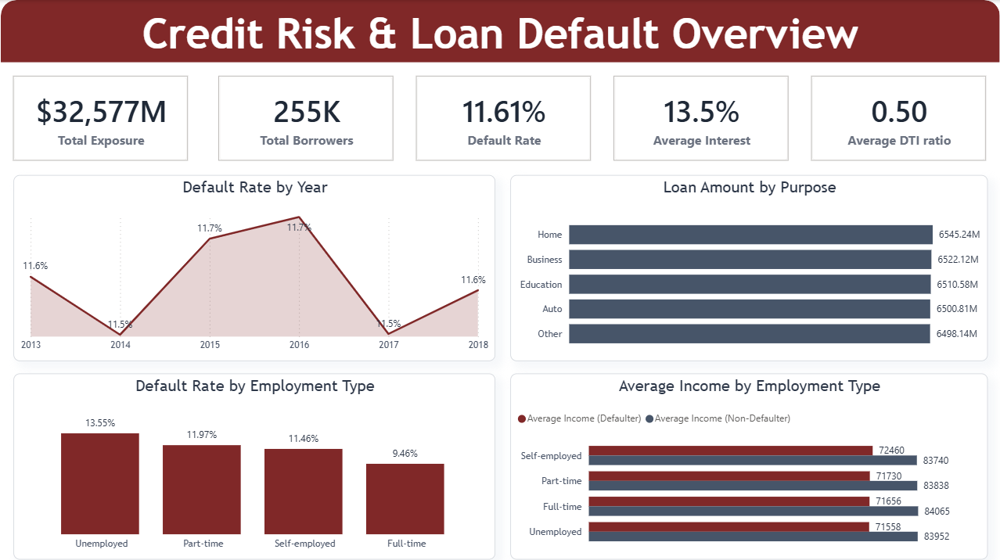
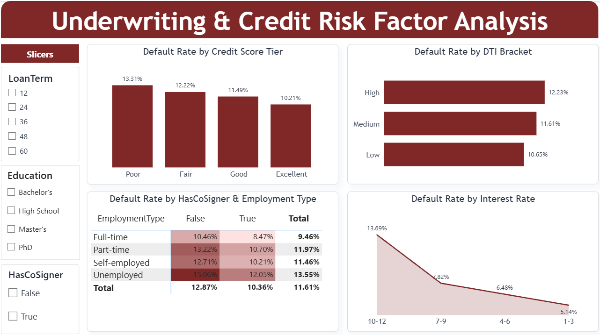
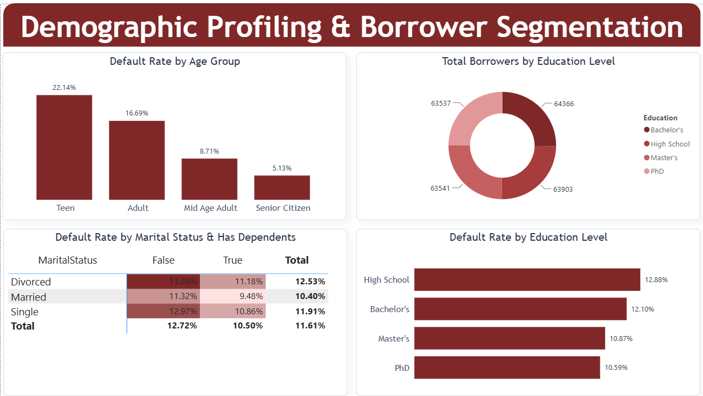
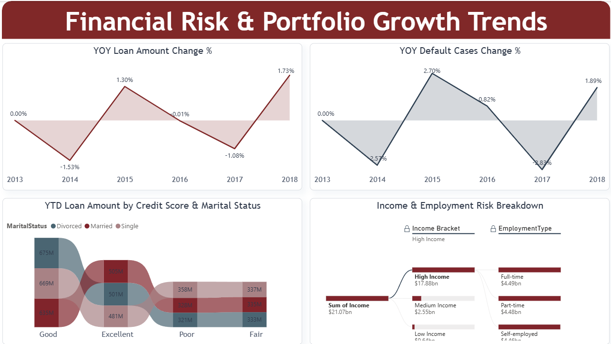

# 🏦 Banking Loan Default & Risk Analysis

**Which borrower and loan factors are linked to default? A credit risk analysis of $32.5B+ in loan exposure across 255K+ borrowers, built with SQL Server, Power BI and DAX.**

🔗 [Download Interactive .pbix File](https://github.com/SahilBhowad/banking-loan-default-risk-analytics/blob/main/Banking%20Loan%20Default%20%26%20Risk%20Analysis.pbix) | 📄 [SQL Queries](https://github.com/SahilBhowad/banking-loan-default-risk-analytics/blob/main/loan_default_queries.sql) | 📊 4-Page Interactive Report | 🛠️ SQL + Power BI + DAX

---

## 📌 The Business Problem

Lenders need to know **who is likely to default, and why**, at the underwriting stage and not only after the loss. This project analyzes a loan portfolio of 255K+ borrowers to find which factors (credit score, co-signer status, age, education, income, interest rate) are most linked to default, so a risk team has data to support its underwriting policy.

**Data:** 255,347 loan records, $32.5B+ total exposure. Columns include loan amount, interest rate, DTI ratio, credit score, age, income, education, employment type, marital status, dependents, co-signer status, loan purpose, loan date and a default flag.

---



---

## 💡 Key Results

* **$32,577M** total exposure across **255K** borrowers, **11.61%** overall default rate, **13.5%** average interest rate.
* Borrowers **without a co-signer** default at **12.87%** vs **10.36%** with one (2.51 percentage points lower).
* **Teen borrowers (19 and under) default at 22.14%**, more than 4x the rate of senior citizens (5.13%).
* Riskiest segment: **divorced borrowers without dependents (13.89%)**. Safest: **married borrowers with dependents (9.48%)**.
* **High-income borrowers** hold **$17.88B of the $21.07B** total borrower income (about 85%).

---

## 🛠️ Tools & Approach

| Stage | What I did |
|---|---|
| Data staging | Loaded the raw CSV into SQL Server (SSMS) and checked schema and data integrity |
| SQL analysis | Wrote 19 queries using CTEs, window functions (`LAG`, `RANK`), conditional aggregation and a reusable view to answer the business questions behind each dashboard page |
| ETL | Built Power BI Dataflows to centralize the transformation steps |
| Data profiling | Used Power Query's Column Quality, Distribution and Profile tools to check data hygiene |
| Modeling | Wrote DAX measures for default rate, exposure, Year-over-Year (YoY) change and YTD loan amount |
| Reporting | 4-page dashboard with KPI cards, heatmaps, a Sankey diagram and a decomposition tree |
| Validation | Recomputed the dashboard numbers in SQL and confirmed they match |

---

## 🔎 Findings

| # | Finding | Evidence | Recommendation |
|---|---|---|---|
| 1 | Co-signers are linked to lower default | 12.87% without vs 10.36% with a co-signer. The gap holds in every employment type (Unemployed 15.06% to 12.05%) | Weight co-signer status in underwriting |
| 2 | Weaker credit tiers default more | Poor 13.31% vs Excellent 10.21% (about 3 points higher) | Weight credit score tier in underwriting |
| 3 | Younger borrowers are the highest-risk age group | Teen 22.14%, Adult 16.69%, Mid Age Adult 8.71%, Senior Citizen 5.13%. Risk falls steadily with age | Apply stricter checks to borrowers under 40, especially those 19 and under |
| 4 | Default rises with interest rate tier | 13.69% in the highest tier vs 5.14% in the lowest | Review monitoring for the highest-rate loans |
| 5 | Higher debt burden means higher risk | High DTI 12.23% vs Low DTI 10.65% | Add a DTI check alongside credit score |
| 6 | Risk factors stack | Divorced without dependents 13.89% vs married with dependents 9.48%. Education also matters (High School 12.88% to PhD 10.59%) | Judge borrowers on combined factors, not one at a time |
| 7 | Borrower income is concentrated in high earners | High-income borrowers hold $17.88B of $21.07B total income | Track concentration in this segment |

**Main recommendation:** weight **co-signer requirement and credit score tier** more heavily for borrowers under 40. Teens (22.14%) and Adults (16.69%) show the highest default rates, which makes this the clearest chance to reduce overall defaults without cutting loan volume.

YoY tracking also flagged **2015 and 2018** as peak years, with default cases changing by **+2.70%** and **+1.89%** year over year, and **2014 and 2017** as dips (**-2.57%** and **-2.83%**).

---

## 🗄️ SQL Analysis

All queries are in [`loan_default_queries.sql`](./loan_default_queries.sql) and follow the four dashboard pages. They recreate the dashboard numbers in SQL Server.

| Page | Queries | Techniques used |
|---|---|---|
| 1. Executive Overview | Q1-Q6: KPIs, default rate by year, loan amount by purpose, employment type, defaulter income | Conditional aggregation, `SUM() OVER()` for share of total |
| 2. Underwriting & Risk Factors | Q7-Q12: credit score tier, DTI bracket, co-signer, interest rate bins, tier + DTI risk ranking | View-based segments, `RANK()`, CTE |
| 3. Demographic Segmentation | Q13-Q15: age group, education, marital status × dependents | Conditional aggregation (pivot style) |
| 4. Portfolio Growth Trends | Q16-Q19: YoY change, YTD loan amount, income bracket, final risk scorecard | `LAG()`, CTEs, `UNION ALL` + `CROSS JOIN` |

**Notes on the SQL**
* A view (`vw_loan_segments`) holds the derived segments (credit tier, DTI bracket, interest rate bin, age group, income bracket). The bin boundaries follow the Power BI definitions.
* Queries that only need raw columns read the `loan_default` table directly.
* The interest rate bin `10-12` is the top bucket and includes every rate above 9%.
* Percentages use 2 decimals throughout.
* YTD (Q17) uses the latest year in the data (2018), the same as the DAX `DATESYTD` measure.

---

## 🧮 DAX Highlights

**Year-over-Year change in default cases:**

```dax
YOY Default Cases Change % = 
VAR CurrentDefaults = COUNTROWS(FILTER('Loan_default', 'Loan_default'[Default] = 1))
VAR PreviousDefaults = 
    CALCULATE(
        COUNTROWS(FILTER('Loan_default', 'Loan_default'[Default] = 1)),
        DATEADD('Date'[Date], -1, YEAR)
    )
RETURN DIVIDE(CurrentDefaults - PreviousDefaults, PreviousDefaults, 0)
```

This measure counts defaults in the current year, uses `DATEADD` to count defaults one year earlier, and returns the % change. `DIVIDE` returns 0 instead of an error when the previous year is zero.

**YTD loan amount:**

```dax
YTD loan amount = 
    CALCULATE(SUM('Loan_default'[LoanAmount]),
    DATESYTD('Loan_default'[Loan_Date_DD_MM_YYYY].[Date]),
    ALLEXCEPT('Loan_default', Loan_default[MaritalStatus], Loan_default[Credit Score Bin]))
```

This measure sums loan amount from January 1 up to the latest date in the data, keeping only the credit score and marital status context for the Sankey diagram.

---

## 📊 Power BI Dashboard

| Page | Shows |
|---|---|
| 1. Executive Overview | Portfolio snapshot and headline KPIs |
| 2. Underwriting & Risk Factors | Credit score tier, DTI bracket, co-signer and interest rate tier |
| 3. Demographic Segmentation | Age, education and marital status |
| 4. Portfolio Growth Trends | YoY loan amount and default change, YTD exposure, income breakdown |

**Page 2: Underwriting & Credit Risk Factor Analysis**


**Page 3: Demographic Profiling & Borrower Segmentation**


**Page 4: Financial Risk & Portfolio Growth Trends**


---

## ⚠️ Limitations & Next Steps

**Limitations**

* The analysis shows patterns, not causes. A link between a factor and default does not prove the factor causes default.
* Factors overlap (for example age and co-signer status), and the dashboard does not separate their effects.
* Default rates are compared across groups without a statistical test, so small differences should be read carefully.
* Segment boundaries (credit score tiers, DTI brackets, interest rate bins, age groups) are fixed cut-offs, and changing them can move the results slightly.

---

## 🚀 How to Use

**Power BI**
1. Download the `.pbix` file from the link at the top.
2. Open it with Power BI Desktop (free).
3. Use the page tabs and slicers to explore the 4 pages.

**SQL**
1. Import `loan_default.csv` into SQL Server using the SSMS Import Flat File wizard (table name: `loan_default`).
2. Open `loan_default_queries.sql` in SSMS and run it from the top. The `sp_rename` line is a one-time setup step and fails if run twice.
3. Compare each query's output with the dashboard page named above it.

---

**Sahil Bhowad** | Aspiring Data Analyst | Mumbai | [LinkedIn](https://www.linkedin.com/in/sahil-bhowad-7a915934a/) | [GitHub](https://github.com/SahilBhowad)
